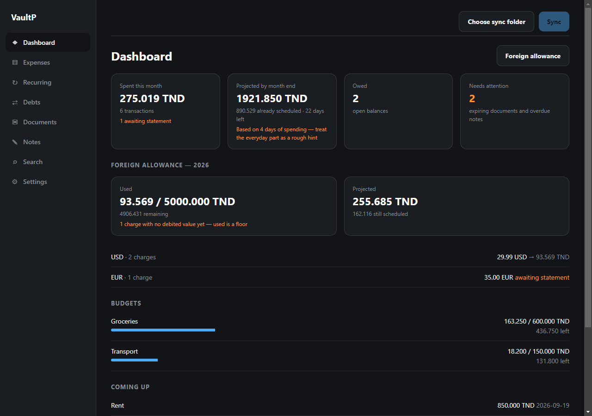
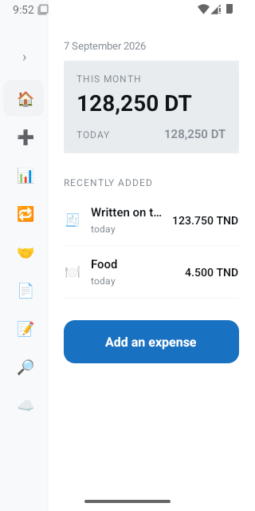
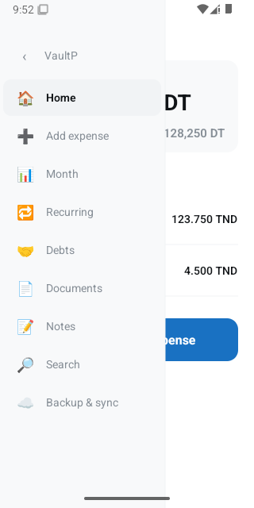
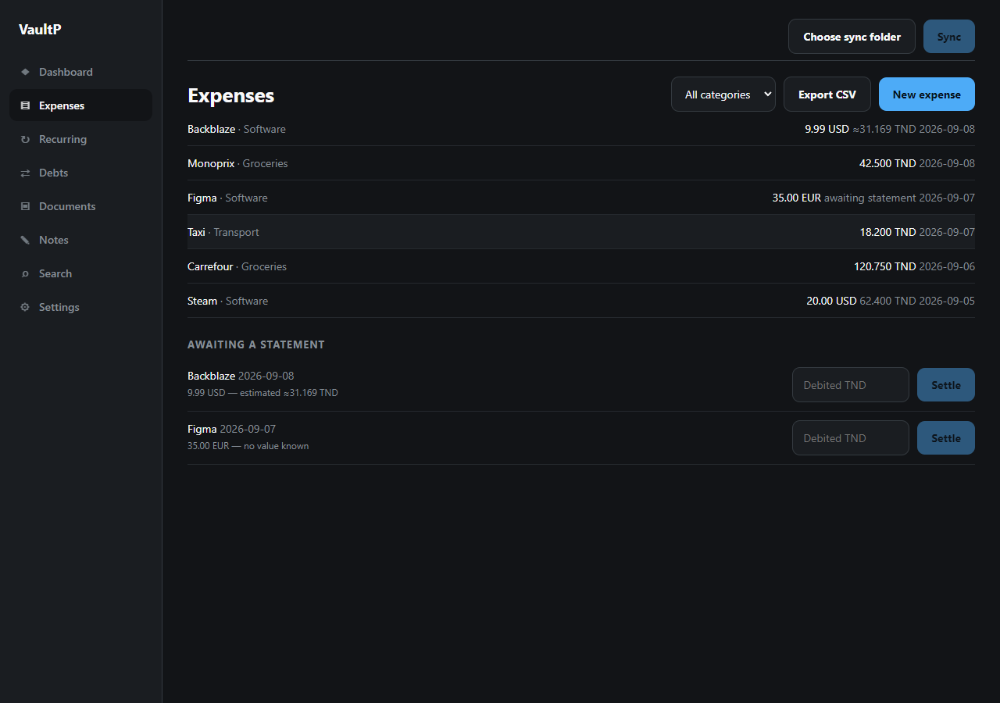

# VaultP

**Your money, your papers, your debts — encrypted, on your own devices, and yours alone.**

A personal vault for expenses, debts, documents and notes, running on an Android phone
and a Windows desktop that share one encrypted database. No server, no account, no
subscription. Every feature works with the network off, forever.

---

## Badges

[](LICENSE)
[](#-getting-started)
[](#-contributing)
[](#-tech-stack)

---

## Hero Visual



> *The desktop dashboard. The phone is a separate design:*

| Phone: home | Phone: sidebar |
| --- | --- |
|  |  |



> *The three states of a foreign charge, kept apart: a plain figure is what the bank
> debited, `≈` is derived from a past rate, and one with no value at all says so rather
> than showing a zero.*

---

## ✨ Features

- 💸 **Expenses built for a real currency** — The Tunisian dinar has **three** decimal
  places, not two. Exponents are always looked up, never assumed, so nothing is
  silently rounded away.
- 🌍 **Honest foreign charges** — Records what the vendor billed *and* what the bank
  actually debited. The spread is part of the rate, so reports show true cost. An
  estimate is marked `≈` and never mistaken for a fact.
- 📅 **Subscriptions that log themselves** — Recurring rules either post automatically
  or just remind you, and a due reminder is one tap from being logged.
- 💳 **Annual foreign-currency ceiling** — Tracked against your spending, with the date
  it is projected to run out.
- 🤝 **Debts as ledgers, not numbers** — Per person, interest computed on read, partial
  payments allocated deterministically. Settlement is a receipt, not an erasure, and
  corrections appear as visible adjustments.
- 📄 **Documents that warn you in time** — Scans encrypted per file and carried between
  devices as ciphertext, text read **on-device** on both so search finds a document by
  what is written inside it, and expiry warnings that respect each document's own lead
  time.
- 📝 **Private notes, Keep-style** — The heart of the app. A note is a title and a
  list of blocks: paragraphs, headings, quotes, bulleted and numbered lists,
  checklists (ticked items can drop to the bottom), dividers, **tables** that grow by
  rows and columns, and **images** — from the gallery, the camera or a pasted
  screenshot, each encrypted like a document scan. Colours, pins, labels, archive,
  and a due date and a reminder kept as separate switches.
- 📁 **Notes arranged by hand** — Hold a note to act on it: let go quickly for its
  options, or keep holding while a line traces the card's border and it lifts off to
  be dragged — between notes to reorder, or onto a folder, label, Archive or Done.
  Folders hold notes one each; labels tag across them. Moving a note writes that one
  note, so two devices reordering offline never fight.
- 🔎 **One search across everything** — Expenses, debts, documents and notes —
  including the words inside checklists, table cells and image captions.
- 🌿 **A calm palette** — Money coming back in sage, money going out and dates
  drawing near in ochre, never alarm red. Light and dark themes follow the system,
  from one set of design tokens both apps share.
- 📷 **Pair by scanning a code** — The computer shows a QR code, the phone scans it,
  and from then on the two keep in step by themselves over the Wi-Fi they share. No
  account, no folder to set up, nothing to install, and nothing leaves the house.
- 🔓 **Unlock the computer with your phone** — No passphrase to type, or to forget:
  the computer shows a one-time code, the phone scans it and asks for your
  fingerprint, and hands the key across sealed so only that computer can open it. The
  same scan sets up a brand-new computer. Passphrase fields can be shown while typing,
  and a computer whose passphrase is truly gone can start over — its old vault is
  moved to a backup folder, never deleted.
- 🔄 **Sync without a service** — Or point both devices at any folder something else keeps
  in step (Syncthing, a shared drive, a USB stick). No account, no API key, nothing
  that expires. The folder receives **ciphertext only**.
- ☁️ **Or your own Google Drive** — The same four operations against Drive instead,
  through *your* Google project and *your* quota, scoped so the app can touch nothing
  but the folder it makes. Google stores the identical ciphertext.
- 🔐 **Encryption you own** — A random data key wrapped by your passphrase, unwrapping
  to separate keys for database, files and sync. The passphrase is never stored and is
  the only recovery path.
- 👆 **Fingerprint unlock** — Day to day, through the Android Keystore.
- 🕓 **An event log underneath it all** — Every change is an appended event; the tables
  are a replayable cache. That single mechanism gives the audit trail, undo, versioned
  backup and conflict-free sync.

---

## 💻 What runs where

Both apps read and write the same vault, and every decision about *what is true* comes
from the shared core, so they agree by construction rather than by discipline.

| | Phone | Desktop |
|---|---|---|
| Expenses, debts, recurring rules, budgets, search, backup | ✅ | ✅ |
| Rich notes: checklists, tables, images, headings, colours, labels, archive | ✅ | ✅ |
| Note folders and drag-to-arrange | ✅ *(hold, trace, drag)* | ✅ *(drag, or hold; right-click for options)* |
| Paste a screenshot into a note | ✅ | ✅ *(Ctrl+V or drop a file)* |
| Dashboard, forecast, foreign-currency allowance | ✅ | ✅ |
| Pair by QR code and sync directly over Wi-Fi | ✅ *(scans)* | ✅ *(shows the code, hosts the exchange)* |
| Sync to a folder (Syncthing, a shared drive, a stick) | ✅ | ✅ |
| Sync to Google Drive | ✅ *(inherits the connection)* | ✅ *(signs in)* |
| Document records, tags, expiry reminders | ✅ | ✅ |
| Scans stored encrypted, per file, and synced | ✅ | ✅ |
| Text read out of a scan (OCR) | ✅ *(ML Kit)* | ✅ *(Tesseract, WebAssembly)* |
| Notifications, fingerprint unlock | ✅ | — |

> **Scans travel too, and travel sealed.** A file is encrypted under a key derived for
> it alone before it is ever written, so sync copies the ciphertext across verbatim —
> it never holds a file key, and the folder never holds anything readable. Deleting a
> document takes the bytes off both devices and out of the folder.

> **Pairing is the sync folder with a wire in it.** The computer keeps a small store of
> the same encrypted objects a sync folder would hold and answers four questions about
> it — list, get, put, delete — over HTTP on the local network. The phone asks them. So
> nothing about how changes merge is new; only the transport is. Every message is signed
> with a secret that travelled in the QR code and never over the network, and the phone
> finds the computer again by itself if the router hands it a new address.

> **Notes stay readable to an older build.** A note's blocks are stored as structured
> data, and a plain-text rendering is kept beside them — `☐` / `☑` for checklist
> items, `|` between table cells. That copy is what search reads, what a reminder
> quotes, and what a device still on an older version shows, so upgrading one device
> first never leaves the other looking at garbage. A block type an older build does not
> know is kept verbatim and written back untouched.

> **OCR runs on the machine, on both.** The phone uses Android's on-device model, the
> desktop runs Tesseract compiled to WebAssembly in its own process. The language data
> — English, French and Arabic — is an ordinary dependency copied out of `node_modules`
> on first use, not a download, so recognition works on a machine that has never been
> online.

---

## 🛠 Tech Stack

### Shared core

> No UI, no platform APIs. Everything that decides *what is true* lives here and runs
> identically on both devices.

| | |
|---|---|
| **Language** | TypeScript 5.6 (npm workspaces monorepo) |
| **Ordering** | Hybrid Logical Clocks, per-field last-write-wins merge |
| **Identity** | UUIDv7, plus deterministic ids for idempotent cross-device creation |
| **Crypto** | AES-256-GCM, PBKDF2, HKDF (portable SHA-256 implementation) |
| **Tests** | Vitest — 458 core, 42 desktop |
| **Design** | Shared tokens (colour roles, type, spacing, note shades) consumed by both apps |

### 📱 Mobile app

| | |
|---|---|
| **Framework** | React Native 0.86 + Expo SDK 57 (New Architecture, Hermes) |
| **Database** | `@op-engineering/op-sqlite` with SQLCipher |
| **Crypto** | `react-native-quick-crypto` (Nitro modules) — native, because PBKDF2 in JS took 3.8s on device |
| **Secrets** | `expo-secure-store` + `expo-local-authentication` (Android Keystore, fingerprint) |
| **OCR** | `@react-native-ml-kit/text-recognition`, on-device |
| **Sync I/O** | `expo-file-system` over a Storage Access Framework folder |
| **Notes** | `expo-image-picker`, `expo-clipboard` for pasted screenshots; gestures on React Native's own `PanResponder` and `Animated` |
| **Target** | Android, `minSdk 24` / `targetSdk 36`, `arm64-v8a` |

### 🖥 Desktop app

| | |
|---|---|
| **Shell** | Electron 33 + electron-vite 5 |
| **UI** | React 19 |
| **Database** | `better-sqlite3-multiple-ciphers` (same SQLCipher format as the phone) |
| **Crypto** | WebCrypto |
| **OCR** | `tesseract.js` (WebAssembly), language data bundled — never fetched |
| **Process model** | Vault lives in the main process; the renderer gets named IPC channels only — no Node, no filesystem, no keys |

---

## 🚀 Getting Started

### Prerequisites

| Requirement | Version | Needed for |
|---|---|---|
| **Node.js** | ≥ 20 (developed on 24) | everything |
| **npm** | ≥ 10 (workspaces) | everything |
| **JDK** | 17 (Temurin) | mobile |
| **Android Studio** | with SDK Platform 36 + Build Tools | mobile |
| A device or emulator | Android 7.0+ | mobile |

> The desktop app needs no C++ toolchain — native binaries are downloaded prebuilt.

### 1. Clone and install

```bash
git clone https://github.com/maysalim-sudo/VaultP.git
cd VaultP
npm install
```

> One install at the root covers all three workspaces.

### 2. Verify the checkout

```bash
npm test
```

> **500 tests** should pass (458 core + 42 desktop). One test is skipped unless you
> opt in — see *Environment variables* below.

```bash
npm run typecheck
```

### 3. Run the desktop app

```bash
cd apps/desktop
npm run dev
```

> `predev` swaps in the SQLite binary built for Electron's ABI, downloading it the
> first time. **This is not optional** — a Node-ABI binary fails the moment a vault is
> opened, which is immediately after the passphrase is accepted.

### 4. Run the mobile app

Connect a device with USB debugging enabled (or start an emulator), then:

```bash
cd apps/mobile
npm run android
```

> First build takes several minutes. Afterwards, `npm start` serves JS to the installed
> app.

### 5. Build a signed release APK

Release signing is **optional** — without a keystore the build still works, using the
debug key. To sign properly, create your own keystore:

```bash
keytool -genkeypair -v \
  -keystore apps/mobile/android/app/vaultp-release.keystore \
  -alias vaultp -keyalg RSA -keysize 2048 -validity 10000
```

Then create `apps/mobile/android/keystore.properties`:

```properties
VAULTP_STORE_FILE=vaultp-release.keystore
VAULTP_STORE_PASSWORD=<your store password>
VAULTP_KEY_ALIAS=vaultp
VAULTP_KEY_PASSWORD=<your key password>
```

```bash
cd apps/mobile/android
./gradlew assembleRelease
```

The APK lands in `apps/mobile/android/app/build/outputs/apk/release/app-release.apk`
(~62 MB). **Check what actually signed it** rather than assuming — an edit to
`build.gradle` that targets a block the template does not have fails silently:

```bash
apksigner verify --print-certs app-release.apk
```

A real release key prints your own certificate. `CN=Android Debug` means the keystore
was not picked up and the build fell back to the debug key.

> ⚠️ **Both the keystore and `keystore.properties` are git-ignored, and both are
> irreplaceable.** Back them up. Android refuses to install a build over one signed
> with a different key, so losing them means uninstalling to update — and uninstalling
> erases the vault. Debug and release deliberately share one key so you can move
> between them freely.

### 6. Package the desktop app

```bash
npm run package:desktop
```

Two artefacts land in `apps/desktop/release/`:

| File | For |
|---|---|
| `VaultP-Setup.exe` | An installer. Per-user, so it needs no administrator, and it asks where to install. Updates itself. |
| `VaultP-portable.exe` | One self-contained executable. For a borrowed machine, or a stick carried next to the sync folder. Does not update itself. |

Both open the same vault, kept in `%APPDATA%\@vaultp\desktop`.

> They are ~116 MB, most of it the OCR engine and its three languages. That is the price
> of recognition that never calls out to a service.

> `prepackage` installs the **Electron** SQLite binary, so `npm test` will report the ABI
> error until it swaps the Node one back in. It does that itself; the error between the
> two steps is expected.

> The executables are not code-signed. Windows SmartScreen will warn on first run —
> *More info → Run anyway*. Signing needs a certificate that costs money and identifies
> a publisher, which is a decision for whoever ships this, not a build setting.

### 7. Back up to Google Drive (optional)

Sync normally goes to a folder — something Syncthing, a shared drive or a USB stick
keeps in step. Drive is an alternative destination for the same thing, and needs
**your own Google credentials**, because a public repository cannot ship a client
secret and this app does not hold an account with anybody.

**Once, in [Google Cloud Console](https://console.cloud.google.com/):**

1. Create a project.
2. Enable the **Google Drive API** for it.
3. Configure the **OAuth consent screen**: *External*, and add your own Google account
   under **Test users**. A personal app stays in *Testing* — it never needs Google's
   verification, and a refresh token issued in that mode is good for seven days at a
   time unless you publish the app.
4. Create an **OAuth client ID** of type **Desktop app**. Copy the client ID and secret.

**Then, in VaultP on the desktop:** *Settings → Google Drive → Connect Google Drive*,
paste both, and sign in through the browser window that opens. Pick **Sync to Google
Drive** in the top bar and sync as usual.

**On the phone:** nothing to sign in to. The connection lives inside the vault, so it
arrives with the next sync — sync the phone through a folder once, or restore a backup
taken after connecting, and *Sync → Google Drive* becomes available.

| | |
|---|---|
| **Scope** | `drive.file` — only files this app creates. It cannot read the rest of your Drive. |
| **What Google stores** | The same ciphertext a shared folder would receive. Object names and sizes are visible; contents are not. |
| **Where credentials live** | Inside the vault, encrypted under your passphrase — which is why a locked vault cannot sync. |

> Revoking access at [myaccount.google.com/permissions](https://myaccount.google.com/permissions)
> stops future syncs. It does not delete what is already in the folder.

### Environment variables

**None are required to run the app.** The vault is local and there is nothing to
configure. These only enable optional tests:

| Variable | Purpose |
|---|---|
| `VAULTP_SYNC_FOLDER` | Folder a phone syncs to. Enables the cross-device write test. |
| `VAULTP_SYNC_PASSPHRASE` | Passphrase for that vault. Required alongside the above. |
| `VAULTP_ANDROID_FIXTURE` | Overrides the committed Android-written fixture path. |

```bash
# Optional: prove the desktop can write something a real phone will read
VAULTP_SYNC_FOLDER=/path/to/synced/folder \
VAULTP_SYNC_PASSPHRASE='the vault passphrase' \
npm test --workspace @vaultp/desktop
```

### 8. Publish a release

Releases are built by GitHub Actions ([`.github/workflows/release.yml`](.github/workflows/release.yml))
when a version tag is pushed. Nothing is published unless the typecheck and the
tests pass first.

```bash
node scripts/set-version.mjs 0.2.0   # every package, app.json, and Android's versionCode
# write the "## 0.2.0" entry in CHANGELOG.md, then commit
git tag v0.2.0
git push origin master v0.2.0
```

The release ends up holding:

| File | For |
|---|---|
| `VaultP-Setup.exe` | The Windows installer. Installed copies update themselves from here. |
| `VaultP-portable.exe` | The portable build. It does not update itself. |
| `latest.yml`, `*.blockmap` | What installed copies read to find and download an update. |
| `VaultP.apk` | Android, for direct download from the website. |
| `VaultP.aab` | Android, for uploading to the Play Console. |
| `SHA256SUMS.txt` | Checksums of all of the above. |

The website's download buttons link to `releases/latest/download/…`, so they never
need editing.

**Android signing in CI.** Add four repository secrets (*Settings → Secrets and
variables → Actions*):

| Secret | Value |
|---|---|
| `ANDROID_KEYSTORE_BASE64` | The keystore, base64-encoded: `[Convert]::ToBase64String([IO.File]::ReadAllBytes("vaultp-release.keystore"))` |
| `ANDROID_STORE_PASSWORD` | From `keystore.properties` |
| `ANDROID_KEY_ALIAS` | From `keystore.properties` |
| `ANDROID_KEY_PASSWORD` | From `keystore.properties` |

Without them the Android job stops rather than sign with the debug key. A
debug-signed APK cannot update anyone's install. The job also checks the
certificate after building.

**Play Store.** Enrol in *Play App Signing* and register this keystore as the
**upload key**. Google then holds the key installs are signed with, and a lost
upload key can be reset. Upload `VaultP.aab` from each release.

> ⚠️ An APK installed from the website and the Play Store version may not be
> signed by the same key once Play App Signing is on. Android will not update one
> with the other, and switching means uninstalling, which erases the vault. Pick
> one channel for Android and point people to it.

**How versions stay compatible.** Every database change is an added migration,
and fields a build does not know are kept rather than dropped. A phone and a
computer one version apart still sync. A build that finds a vault opened by a
*newer* version refuses it and says to update, without changing anything.

---

## 📂 Project Structure

```
VaultP/
├── packages/
│   └── core/                  Domain logic. No UI, no platform APIs.
│       └── src/
│           ├── money/         Currencies, exponents, parsing, conversion
│           ├── clock/         Hybrid logical clocks
│           ├── oplog/         Event definitions and replay
│           ├── db/            Store, migrations, entities
│           ├── expenses/      Repository, recurrence, forecast, allowance
│           ├── debts/         Ledger, interest, repository
│           ├── documents/     Repository, expiry
│           ├── notes/         Blocks, plain-text rendering, folders, labels, order
│           ├── design/        Tokens both apps draw from
│           ├── crypto/        AES-GCM, HKDF, PBKDF2, keyfiles
│           └── sync/          Segments, backends, sync engine
│
├── apps/
│   ├── mobile/                React Native (Android)
│   │   ├── src/
│   │   │   ├── screens/       Home, entry, debts, documents, notes, sync
│   │   │   ├── notes/         Block editor, hold-and-drag cards, images, folders
│   │   │   ├── components/    Sidebar, amount pad, date field, theme
│   │   │   ├── vault/         Key handling, unlock, database
│   │   │   ├── sync/          SAF folder backend
│   │   │   └── crypto/        Native crypto provider
│   │   └── android/           Native project (committed, including signing config)
│   │
│   └── desktop/               Electron (Windows)
│       ├── src/
│       │   ├── main/          Vault, database, folder backend, IPC
│       │   ├── preload/       The narrow bridge
│       │   └── renderer/      React UI (notes/ holds the block editor)
│       ├── scripts/           Native ABI swap
│       └── test-fixtures/     A vault written by a real Android build
│
├── docs/                      Screenshots
└── ARCHITECTURE.md            Why it is built this way
```

---

## 🤝 Contributing

Contributions are welcome — issues, fixes, and ideas alike.

**Before you start,** read [`ARCHITECTURE.md`](ARCHITECTURE.md). It explains why the
system is shaped the way it is, and the decisions that look like over-caution until you
know the bug behind them: three-decimal currencies, the native ABI swap, Storage Access
Framework rules, and why an estimate must never be presented as a fact.

A few rules are not negotiable, because breaking one corrupts data quietly:

- **Never store or guess a passphrase.** It is typed by the vault's owner and exists
  nowhere else.
- **Never present an estimate as a fact.** A foreign expense is a real debited amount,
  an estimate marked `≈`, or *no value at all* — and the third is never zero.
- **Never assume two decimal places.** TND has three, JPY has none. Exponents are looked
  up, never defaulted.
- **Decisions about what is true live in `packages/core`.** Both devices must reach the
  same answer, which only holds if the answer comes from one implementation.

1. **Fork** the repository and create a branch: `git checkout -b my-change`
2. **Make the change**, matching the surrounding style. Comments here explain *why*, not
   *what*.
3. **Add a test.** Anything touching money, dates, merges or crypto needs one — those
   are the places where a bug is silent.
4. **Run the suite:** `npm test && npm run typecheck`
5. **Commit** with a message that says what changed and why the change is right.
6. **Open a pull request** describing the behaviour before and after.

> Bug reports are most useful with the currency, the dates involved, and what you
> expected. Money bugs hide in the specifics.

> **Found a security problem?** Do not open an issue — see [`SECURITY.md`](SECURITY.md).
> It also sets out what is protected and what is deliberately not, which is worth
> reading before trusting this with anything.

---

## 📄 License

Released under the **MIT License**. See [`LICENSE`](LICENSE) for the full text.
